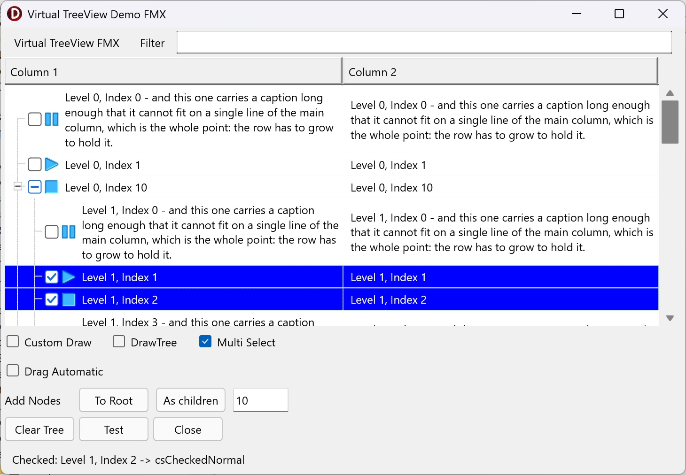

# FmxVirtualTreeView

Virtual TreeView for **Delphi 12**, buildable for both **VCL** and **FireMonkey** from one
set of sources.

Virtual Treeview is a Delphi tree control built from the ground up. It is virtual: the
control holds no data of its own, it asks your application for the text, images and states
it needs while it paints. That is what makes it fast with very large trees, and what makes
it flexible enough to be used as a list, a grid, a report view or a tree.

## Where this comes from

This is a fork of a fork, and the chain matters when you go looking for something and cannot
find it:

- **Virtual Treeview**, by Mike Lischke and later maintained by JAM Software —
  https://github.com/Virtual-TreeView/Virtual-TreeView
- **livius2's FireMonkey port**, begun in 2019 and last updated on 30 June 2024 —
  https://github.com/livius2/Virtual-TreeView
- **this repository**, which continues that port.

So the code here descends from Virtual Treeview as it stood when the FireMonkey port was
started, not from today's upstream. Nothing released upstream since has been merged in. If you
are looking for a fix or a feature that arrived in Virtual Treeview after 2019, assume it is
not here — and if you merge it yourself, a pull request is welcome.

## Status

This is a **working but incomplete** fork, maintained for my own applications. The VCL side is
close to the upstream it was forked from; the FireMonkey side is a port that has been carried
far enough to be useful on **Windows and Android**, and has had its first runs on macOS.

| Platform                 | Framework | Status                                   |
|--------------------------|-----------|------------------------------------------|
| Windows 32/64-bit        | VCL       | Tested                                   |
| Windows 32/64-bit        | FMX       | Tested                                   |
| Android 64-bit           | FMX       | Tested                                   |
| macOS ARM 64-bit         | FMX       | Runs, basic testing only                 |
| iOS Simulator ARM 64-bit | FMX       | Compiles and links, not yet run          |
| iOS device               | FMX       | Not tested                               |

What is known to work under FMX: variable and multiline node heights, system and custom
check boxes including tri-state, column headers with resizing and a built-in column popup,
mouse and touch scrolling, pan gestures, in-place editing, multi-select, drag images, a
context menu opened by right click or press and hold, and the usual painting options
(buttons, tree lines, grid lines, hot tracking, blended selection).

What is missing or untested under FMX: OLE drag and drop, the clipboard, printing, iOS at
run time, and accessibility. Several of these are Windows-only in the original design and
would need real work rather than a port.

### Building for macOS and iOS with Delphi 12.1

Delphi 12.1 is older than current Xcode releases, and that shows in the SDK Manager rather
than in this code:

- **macOS:** Delphi 12.1 cannot link against the macOS 27 SDK (`E2597 ld: missing required
  architecture arm64`). Importing the macOS 14.5 SDK instead — it ships with Command Line
  Tools for Xcode 15.4 — works.
- **iOS Simulator:** Xcode 27 refuses simulator SDKs older than its own, so the 27.0 SDK is
  the one to import. It links once `_LocationEssentials` is added to that SDK in the SDK
  Manager as a framework (path `$(SDKROOT)/System/Library/Frameworks`, type Framework)
  followed by *Update Local File Cache*. The Delphi 12.1 debugger cannot set breakpoints in
  the iOS 27 simulator; use *Run Without Debugging*.

## Requirements

RAD Studio / Delphi 12. Nothing else; there are no external dependencies.

The packages are pinned to Delphi 12's library suffix and will refuse to compile under any
other RAD Studio, with a message saying what to do about it. To build them with a newer
Delphi, read `Packages\README FIRST - OTHER DELPHI VERSIONS.txt` — it is one tool run.

Only one framework can be *installed* in the IDE at a time — the VCL design package and the
FMX design package register components of the same names. You can install one and still
compile the other from source in your projects.

## Installation

1. Open `Packages\VirtualTreesVCL.groupproj` (VCL) or `Packages\VirtualTreesFMX.groupproj`
   (FMX).
2. Build the runtime package — `VirtualTreesVCL_Runtime` or `VirtualTreesFMX_Runtime` — for
   Win32 and then Win64.
3. Right-click the design package — `VirtualTreesVCL_Design` or `VirtualTreesFMX_Design` —
   and choose **Install**. The design packages are Win32 only, because the IDE is a 32-bit
   program.
4. Add `Source` to the IDE's library path (Tools ▸ Options ▸ Language ▸ Delphi ▸ Library) for
   each platform you build for. That path is stored per platform, so adding it for Win32
   alone leaves Win64 and Android64 failing with `F2613 Unit ... not found`.

The components appear on the **Virtual Controls** palette page. `Packages\ReadMe.txt` covers
the same ground in more detail, including how to check that the install worked.

## Using it in a project

Add `Source` to the search path — either the project's own (Project ▸ Options ▸ Building ▸
Delphi Compiler ▸ Search path) or the IDE's library path, for **each platform you build for**.
Miss it and the first compile stops with `F2613 Unit 'VirtualTrees...' not found`; installing
the design package does not do it for you.

**VCL:** add `VirtualTrees` to your uses clause. Nothing else is needed.

**FMX:** add `VirtualTrees` and `VirtualTrees.FMX` to your uses clause. Nothing else is
needed either — no conditional defines. RAD Studio defines `FRAMEWORK_FMX` by itself for a
FireMonkey project, and every unit derives its own `VT_FMX` / `VT_VCL` switch from that, so
the framework is selected for you.

## Demos

`Demos\TestTreeViewVcl` and `Demos\TestTreeViewFmx` are two small projects built around the
same tree so the two frameworks can be compared side by side. They are the fastest way to
see what works.

**They need no setup.** Each `.dpr` lists the library units with relative paths, so both demos
build straight from a fresh clone with nothing added to any search path. If you want to see
how to reference the source from your own project, their `.dpr` files are the example.

### Editing the VCL demo form

`uFormVcl.dfm` was laid out in a RAD Studio started DPI-unaware:

    bds.exe /highdpi:unaware

Compiling it is fine at any DPI, and so is opening it to look at. What is not fine is opening
it in the form designer at a different DPI **and saving**: the VCL designer rewrites every
coordinate in the file to match your monitor, so the whole `.dfm` changes at once and the
layout moves for everyone else. On a high-DPI screen with a DPI-aware IDE the form also just
looks wrong — too small — which is a symptom of the same thing and not a fault in the demo.

If you want to change that form, start the IDE DPI-unaware as above. If you would rather not,
say in the pull request that the `.dfm` was rewritten, so the diff is not mistaken for a
layout change. The FMX demo has no such problem: FireMonkey forms are resolution independent
and carry no `PixelsPerInch`.

## Documentation

`Source\VirtualTrees.dtx` is the Doc-O-Matic source for the API reference and is kept in
step with the code. No compiled help file is shipped.

## Differences from the original

- `VirtualTrees.HeaderPopup.pas` is gone. The header's own column popup menu lives in
  `VirtualTrees.Header.pas`, so `hoAutoColumnPopupMenu` works without an extra component.
- The VCL in-place editor is single-line by default; `Return` commits instead of inserting a
  newline. Set `EditorMultiline := True` on the tree for the old behaviour.
- `SelectOnMouseUp` delays selection until the finger or button is released, so a swipe on a
  touch screen scrolls without selecting.
- Various FMX fixes: node heights are measured and re-measured correctly, the scroll range
  follows column and control resizing, check images are drawn rather than loaded from
  Windows themes, pan gestures reach the tree, and dtFMX drags show a ghost image that
  follows the pointer.
- FireMonkey has no right button outside Windows and never dispatches `WM_RBUTTONUP`, so the
  FMX tree recognises the context gesture itself: `PopupTrigger` (right click, press and hold,
  or both), `PopupDelay`, an `OnContextMenu` event, and a `Popup: TPopup` shown when the
  gesture is recognised. A `TPopup` is an ordinary control, so one menu serves Windows and
  Android; the inherited `PopupMenu` is used when `Popup` is nil, and now opens on a right
  click for the first time under FMX.
- The FMX tree fires `OnMouseDown`, `OnMouseUp` and `OnDblClick`. `TVTAncestorFMX.MouseDown`
  deliberately does not call `inherited`, so `TControl` never raised them; they are fired
  explicitly instead.
- Design-time registration is in `Packages\VirtualTreesReg.pas` for both frameworks.

## Licence

Virtual Treeview is published under a double licence: **MPL 1.1** and **LGPL 2.1 with the
static linking exception** as described at http://wiki.freepascal.org/modified_LGPL. This
fork keeps that licence. The licence headers in the source files are the authoritative text.

Files in `Source` have been modified relative to the original release; the git history of
this repository records the changes made here.

## Credits

Virtual Treeview is the work of many people over more than two decades, and this fork is a
small addition on top of theirs.

- **Mike Lischke** — original author of Virtual Treeview.
- **JAM Software / Joachim Marder** — took the project under their wing in 2014 and
  maintained it through version 7.x: https://github.com/Virtual-TreeView/Virtual-TreeView
- **livius2** — the experimental FireMonkey port this fork is based on:
  https://github.com/livius2/Virtual-TreeView
- **Jan Rames**, **Fr0sT-Brutal**, **Stefan Glienke**, **blikblum** and the many other
  contributors to the upstream project and its forks.

## Support

Please do not contact Mike Lischke, JAM Software or livius2 about this fork. Please do not
contact me for support either — I use this code, I do not support it. Questions about
Virtual Treeview in general are best asked on Stack Overflow or Delphi-Praxis.
